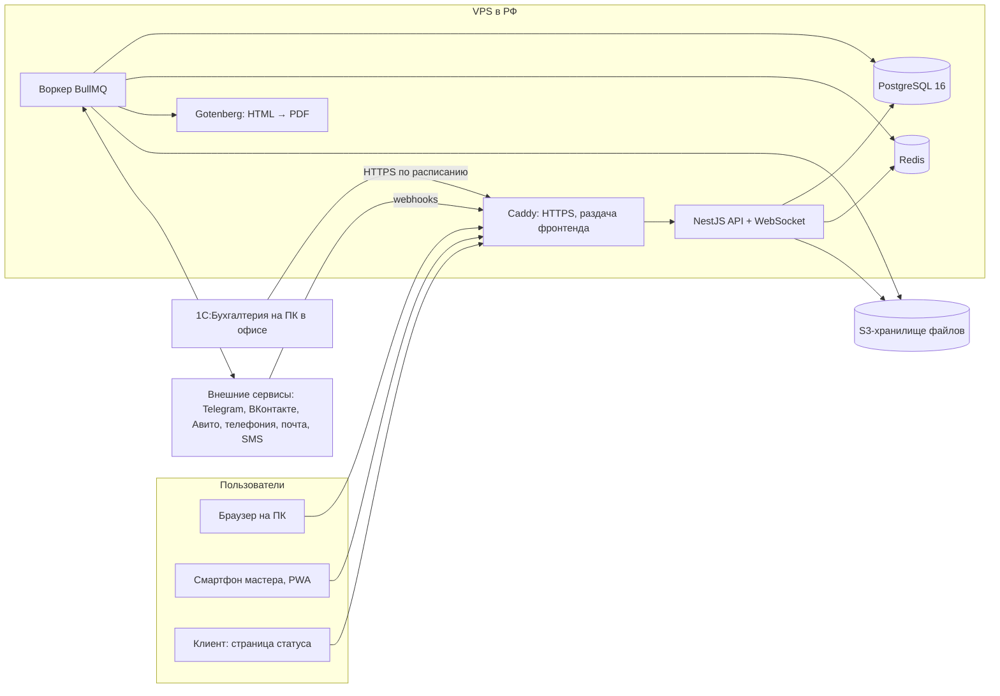

# 01. Архитектура

## 1. Общая схема


- **API** обрабатывает запросы интерфейса, webhooks внешних сервисов и обмен с 1С, держит WebSocket-соединения.
- **Воркер** — тот же код NestJS, запущенный в режиме обработки очередей: отправка уведомлений, генерация PDF, опрос почты, задачи по расписанию. Медленные и ненадёжные операции никогда не выполняются в запросе пользователя.
- **1С** сама обращается к CRM, потому что ПК в офисе недоступен из интернета (см. [Интеграции](05-интеграции.md#1-1сбухгалтерия-предприятия)).

## 2. Стек
| Слой | Технология | Зачем |
|---|---|---|
| Язык | TypeScript (strict) | Один язык на сервере и в интерфейсе, общие типы |
| Монорепозиторий | pnpm workspaces | `apps/api`, `apps/web`, `packages/shared` |
| Сервер | NestJS 10 | Модули, DI, guards для прав, встроенная поддержка WebSocket и очередей |
| ORM | Prisma | Схема БД в одном файле, миграции, типизированные запросы |
| БД | PostgreSQL 16 | Надёжная реляционная БД, полнотекстовый поиск по-русски |
| Очереди | Redis 7 + BullMQ | Фоновые задачи, повторы при ошибках, задачи по расписанию |
| Реальное время | Socket.IO | Чат, лента заказа, живое обновление канбана |
| Валидация | Zod (в `packages/shared`) | Одни и те же схемы проверяют данные в интерфейсе и на сервере |
| Интерфейс | React 18 + Vite | Быстрая сборка, большое сообщество |
| UI-библиотека | Ant Design 5 | Готовые таблицы, формы, календарь, русская локаль |
| Данные в интерфейсе | TanStack Query | Кеш, повторы, обновление после изменений |
| Роутинг | React Router 6 | |
| Мобильная версия | PWA (vite-plugin-pwa) | Установка на смартфон, камера, push-уведомления, без публикации в сторы |
| Документы | Handlebars + Gotenberg | HTML-шаблоны с подстановкой данных → PDF |
| Файлы | S3-совместимое хранилище хостинга, в разработке MinIO | Фото, вложения, PDF, записи звонков |
| Тесты | Vitest (юнит), Supertest (API), Playwright (e2e) | |
| Качество кода | ESLint, Prettier, Husky + lint-staged | |
| Развёртывание | Docker Compose, GitHub Actions | |

## 3. Структура репозитория
```
срм/
├── apps/
│   ├── api/                 # NestJS: REST, WebSocket, воркер
│   │   ├── prisma/          # schema.prisma, миграции, seed
│   │   └── src/
│   │       ├── common/      # guards, interceptors, фильтры ошибок, аудит
│   │       ├── auth/
│   │       ├── users/
│   │       ├── clients/
│   │       ├── leads/
│   │       ├── orders/
│   │       ├── visits/
│   │       ├── communication/
│   │       ├── tasks/
│   │       ├── notifications/
│   │       ├── warehouse/
│   │       ├── documents/
│   │       ├── client-notify/
│   │       ├── analytics/
│   │       └── integrations/  # one-c, telephony, email, site, vk, avito, telegram, sms
│   └── web/                 # React
│       └── src/
│           ├── app/         # роутинг, провайдеры, layout
│           ├── features/    # по модулям: clients, orders, ...
│           ├── shared/      # общие компоненты, api-клиент, хуки
│           └── pwa/
├── packages/
│   └── shared/              # Zod-схемы, типы, константы (роли, статусы)
├── infra/
│   ├── docker-compose.yml       # разработка
│   ├── docker-compose.prod.yml  # сервер
│   ├── Caddyfile
│   └── backup/
├── docs/                    # это ТЗ
└── Идея проекта.md
```

## 4. Многокомпанийность (задел на продажу)
- **АРХ-1** (Э1, обязательно). Все бизнес-таблицы содержат `company_id`. Любой запрос к БД фильтруется по компании текущего пользователя. Фильтр добавляется централизованно (расширение Prisma Client), а не вручную в каждом запросе.
- **АРХ-2** (Э1, обязательно). Настраиваемые вещи хранятся в БД на уровне компании, а не в коде: этапы воронок, шаблоны документов, шаблоны уведомлений клиенту, реквизиты, нумерация документов, справочник источников заявок.
- **АРХ-3** (Э1, обязательно). В MVP одна компания, создаётся при первом запуске seed-скриптом. Регистрация новых компаний и биллинг вне рамок ТЗ.

## 5. Безопасность
- **АРХ-10** (Э0). Только HTTPS (Caddy, автоматический сертификат Let's Encrypt). HSTS.
- **АРХ-11** (Э0). Пароли хранятся в виде хеша argon2id. Минимум 8 символов. После 5 неудачных попыток входа блокировка на 15 минут.
- **АРХ-12** (Э0). Access-токен JWT живёт 15 минут, refresh-токен 30 дней. Refresh хранится в httpOnly Secure SameSite=Strict cookie и ротируется при каждом обновлении. Выход отзывает refresh-токен.
- **АРХ-13** (Э0). Права проверяются только на сервере (guards NestJS). Интерфейс скрывает недоступное, но не является защитой.
- **АРХ-14** (Э0). Все входящие данные проверяются Zod-схемами. SQL только через Prisma (без сырых запросов со склейкой строк).
- **АРХ-15** (Э1). Файлы загружаются в S3 по подписанным ссылкам. Ограничение размера: 20 МБ на файл, 200 МБ для записей звонков. Разрешённые типы: изображения, PDF, офисные документы, аудио.
- **АРХ-16** (Э1). Ссылки на файлы выдаются временные (подписанные, живут 15 минут).
- **АРХ-17** (Э1). Ограничение частоты запросов: 100 запросов в минуту на пользователя, 10 попыток входа в минуту с одного IP, отдельные лимиты для webhooks.
- **АРХ-18** (Э2). Webhooks внешних сервисов проверяются подписью или секретом в URL, указанным в настройках интеграции.
- **АРХ-19** (Э1). Секреты (ключи API, пароли почты) хранятся в БД в зашифрованном виде (AES-256-GCM, ключ в переменной окружения), в интерфейсе не показываются после сохранения.

## 6. Персональные данные (152-ФЗ)
- **АРХ-20** (Э1). Сервер и хранилище файлов у российского хостинга, данные хранятся в РФ.
- **АРХ-21** (Э2). На странице статуса заказа и в Telegram-боте показывается ссылка на политику обработки персональных данных. При заведении физлица менеджер отмечает, что согласие получено (поле «Согласие на обработку ПД» и дата).
- **АРХ-22** (Э1). Журнал действий фиксирует, кто просматривал и менял карточки клиентов.
- **АРХ-23** (Э3). Возможность обезличить клиента по запросу: ФИО, телефоны, почта заменяются, заказы и суммы остаются для отчётов.

## 7. Журнал действий (audit log)
- **АРХ-30** (Э1). Записываются: создание, изменение и удаление клиентов, заказов, позиций, оплат, движений склада, документов, пользователей и прав; смена этапа заказа; вход в систему и неудачные попытки.
- **АРХ-31** (Э1). Запись содержит: кто, когда, что (сущность и ID), действие, старые и новые значения изменённых полей, IP.
- **АРХ-32** (Э1). Журнал только дописывается. Изменять и удалять записи нельзя никому, включая администратора.
- **АРХ-33** (Э1). Руководитель видит журнал по любой сущности (вкладка «История» в карточке) и общий журнал с фильтрами.

## 8. Удаление данных
- **АРХ-40** (Э1). Бизнес-сущности не удаляются физически: используется мягкое удаление (`deleted_at`). Удалённое скрыто из интерфейса, но остаётся в БД и отчётах прошлых периодов.
- **АРХ-41** (Э1). Нельзя удалить клиента с заказами, номенклатуру с движениями, заказ с оплатами или документами. Вместо этого их можно архивировать.

## 9. Развёртывание
- **АРХ-50** (Э0). Разработка: `pnpm dev` запускает встроенный PostgreSQL (npm-пакет `embedded-postgres`, без установки в систему), API и web. Файлы в разработке хранятся на диске (`.data/uploads`), фоновые задачи выполняются в процессе API. Когда на компьютере есть Docker, `docker compose up` дополнительно поднимает redis, minio, gotenberg, mailpit (перехват почты) — они нужны с этапа 2.
- **АРХ-51** (Э1). Сервер: VPS у российского хостинга (Selectel, Timeweb Cloud или аналог). Минимум 2 vCPU, 4 ГБ RAM, 40 ГБ SSD. ОС Ubuntu 24.04 LTS.
- **АРХ-52** (Э1). На сервере `docker-compose.prod.yml`: caddy, api, worker, postgres, redis, gotenberg. Файлы во внешнем S3.
- **АРХ-53** (Э1). Выкладка через GitHub Actions: тесты → сборка образов → публикация в реестр → на сервере `docker compose pull && up -d` → миграции Prisma. Откат: перезапуск предыдущего тега образа.
- **АРХ-54** (Э1). Переменные окружения в `.env` на сервере, в репозитории только `.env.example`.
- **АРХ-55** (Э1). Отдельный тестовый стенд не обязателен на старте. Перед выкладкой миграций делается бэкап.

## 10. Резервное копирование
- **АРХ-60** (Э1). `pg_dump` каждую ночь в 03:00 МСК, сжатие, загрузка в отдельный бакет S3. Хранение: 30 ежедневных + 12 ежемесячных копий.
- **АРХ-61** (Э1). Файлы в S3 с включённым версионированием или ежедневной репликацией в отдельный бакет.
- **АРХ-62** (Э1). Раз в месяц проверка восстановления из бэкапа на локальной машине. Инструкция восстановления лежит в `infra/backup/README.md`.

## 11. Мониторинг и логи
- **АРХ-70** (Э1). Структурированные логи в JSON (pino), ротация средствами Docker.
- **АРХ-71** (Э1). Эндпоинт `/health` (БД, Redis, S3). Внешний мониторинг доступности (UptimeRobot или аналог) с оповещением в Telegram.
- **АРХ-72** (Э1). Ошибки сервера и интерфейса отправляются в Sentry (или self-hosted GlitchTip).
- **АРХ-73** (Э1). Мониторинг очередей: задачи, упавшие после всех повторов, видны администратору в разделе «Интеграции → Ошибки».

## 12. Нефункциональные требования
| Код | Требование | Значение |
|---|---|---|
| АРХ-80 | Время ответа API для типовых запросов | До 300 мс (95-й перцентиль) |
| АРХ-81 | Открытие карточки заказа | До 1 секунды на ПК, до 2 секунд на смартфоне в 4G |
| АРХ-82 | Доступность | 99% в месяц (не более ~7 часов простоя) |
| АРХ-83 | Доставка сообщения в чате | До 1 секунды |
| АРХ-84 | Одновременные пользователи | До 30 без деградации |
| АРХ-85 | Объём данных | Рассчитано на 1 000 заказов в год и 50 000 файлов без изменения архитектуры |
| АРХ-86 | Браузеры | Последние 2 версии Chrome, Яндекс Браузер, Edge, Safari (iOS 16+), Chrome Android |
| АРХ-87 | Язык интерфейса | Русский. Тексты вынесены в отдельные файлы, чтобы позже добавить другие языки |
| АРХ-88 | Часовой пояс | Хранение в UTC, отображение в часовом поясе компании (настройка) |
| АРХ-89 | Деньги | Хранятся в копейках (целое число), валюта рубль. НДС: настройка компании (без НДС / 20% / иное) |

## 13. Песочница (демо-режим для портфолио)
Рабочая система с реальными клиентами посторонним не показывается (152-ФЗ, коммерческая тайна). Для портфолио и потенциальных заказчиков разворачивается отдельная копия — песочница.

- **ДЕМ-1** (Э1, обязательно). Песочница — тот же код, запущенный с `DEMO_MODE=true` на отдельном поддомене (например, `demo.<домен>`) и с отдельной БД. Рабочая БД с песочницей не связана никак.
- **ДЕМ-2** (Э1, обязательно). На экране входа в песочнице — кнопки «Войти как руководитель / менеджер / мастер / бухгалтер» без пароля и плашка «Песочница: данные вымышленные, можно нажимать всё».
- **ДЕМ-3** (Э1, обязательно). Скрипт демо-данных создаёт правдоподобную картину работы сервиса: 10–15 сотрудников, 40+ клиентов разных типов, реальные модели гидростанций и насосов, заказы на всех этапах всех воронок, реалистичные дефекты, сметы, комментарии, задачи, выезды на текущую неделю. Даты сдвигаются относительно «сегодня», чтобы данные всегда выглядели свежими.
- **ДЕМ-4** (Э1, обязательно). Каждую ночь (и по кнопке администратора) песочница сбрасывается к исходным демо-данным.
- **ДЕМ-5** (Э1, обязательно). В песочнице выключены все внешние отправки: SMS, почта, Telegram, 1С, телефония. Вместо отправки событие пишется в ленту с пометкой «В песочнице не отправляется».
- **ДЕМ-6** (Э1, обязательно). В песочнице нельзя менять пароли, создавать пользователей-администраторов и менять настройки интеграций.
- **ДЕМ-8** (Э1, обязательно). Демо для портфолио без сервера: `pnpm build:demo` собирает интерфейс вместе с демо-сервером в браузере (`apps/web/src/demo-static`). Он отвечает на те же эндпоинты, проверяет данные теми же Zod-схемами и правилами этапов из `packages/shared`. Данные — снимок демо-БД (`pnpm demo:export`), изменения посетителя хранятся в его браузере и синхронизируются между его вкладками. Публикация — GitHub Pages через `.github/workflows/pages.yml`.
- **ДЕМ-7** (Э3, желательно). В рабочей системе — публичный эндпоинт `/public/stats` с обезличенными счётчиками для страницы кейса: заказов обработано, пользователей, дней в работе. Включается настройкой, по умолчанию выключен.

## 14. Тестирование
- **АРХ-90** (Э0). Юнит-тесты для бизнес-правил: переходы этапов, расчёт сметы и маржи, остатки склада, нумерация документов, права.
- **АРХ-91** (Э1). API-тесты на каждый модуль: успешные сценарии и проверка прав (роль без доступа получает 403).
- **АРХ-92** (Э1). E2E-тесты Playwright на ключевые сценарии: вход, заявка → заказ → смена этапов → выдача; выезд со смартфона.
- **АРХ-93** (Э0). CI не пропускает изменения при ошибках линтера, типов или тестов.
