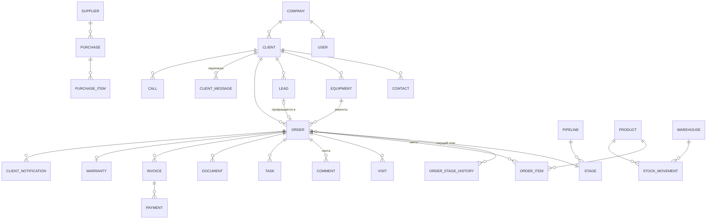

# 03. Модель данных

Модель описывает сущности и их основные поля. Точная схема живёт в `apps/api/prisma/schema.prisma` и должна соответствовать этому файлу.

## 1. Общие правила
- Имена таблиц и полей в коде на английском (`snake_case` в БД, `camelCase` в TypeScript). В ТЗ указаны оба названия.
- Первичный ключ `id` — UUID v7 (сортируется по времени).
- У всех бизнес-таблиц есть `company_id`, `created_at`, `updated_at`, `created_by_id`. У сущностей с мягким удалением — `deleted_at`, у архивируемых — `archived_at`.
- Деньги — целое число в копейках (`*_kop`). Количество — `decimal(12,3)`.
- Даты и время хранятся в UTC (`timestamptz`).
- Человекочитаемые номера (`number`) уникальны в пределах компании: `З-2026-0042` (заказ), `ЗЯ-2026-0101` (заявка). Формат номеров настраивается.

## 2. ER-диаграмма (основные связи)

## 3. Компания, пользователи, роли
**Company** (`companies`)
| Поле | Тип | Описание |
|---|---|---|
| name | text | Название |
| legal_name, inn, kpp, ogrn | text | Реквизиты |
| legal_address, actual_address | text | Адреса |
| bank_name, bik, account, corr_account | text | Банковские реквизиты |
| director_name, director_position | text | Подписант документов |
| vat_mode | enum | `none` / `vat20` / `custom` |
| vat_rate | decimal | Ставка, если `custom` |
| timezone | text | По умолчанию `Europe/Moscow` |
| logo_file_id | uuid | Логотип для документов |
| settings | jsonb | Настройки видимости, лимиты (см. [Роли и права](02-роли-и-права.md#5-настройки-видимости-уровень-компании)) |

**User** (`users`): `email` (логин, уникален), `password_hash`, `full_name`, `phone`, `position`, `is_active`, `telegram_chat_id` (для уведомлений сотруднику), `last_login_at`, `avatar_file_id`.

**Role** (`roles`): `code` (`admin`, `director`, `manager`, `master`, `accountant`), `name`, `permissions` (text[]). **UserRole** (`user_roles`): `user_id`, `role_id`.

**RefreshToken** (`refresh_tokens`): `user_id`, `token_hash`, `expires_at`, `revoked_at`, `user_agent`, `ip`.

## 4. Клиенты
**Client** (`clients`)
| Поле | Тип | Описание |
|---|---|---|
| type | enum | `person` (физлицо) / `ip` / `company` (юрлицо) / `dealer` |
| name | text | ФИО или краткое название |
| legal_name, inn, kpp, ogrn, legal_address | text | Для ИП, юрлиц, дилеров |
| bank_name, bik, account, corr_account | text | Банковские реквизиты |
| phone, email | text | Основные контакты (телефон в формате E.164) |
| address | text | Адрес для выездов |
| source_id | uuid | Откуда пришёл (справочник источников) |
| manager_id | uuid | Ответственный менеджер |
| price_list_id | uuid | Особые цены (для дилеров) |
| payment_terms_days | int | Отсрочка оплаты, дней (0 — предоплата) |
| notify_channels | enum[] | Каналы уведомлений: `telegram`, `email`, `sms` |
| telegram_chat_id | text | Если клиент подписался в боте |
| pd_consent_at | timestamptz | Когда получено согласие на обработку ПД |
| tags | text[] | Метки |
| note | text | Заметка |
| external_1c_id | text | ID контрагента в 1С |

**Contact** (`contacts`): `client_id`, `full_name`, `position`, `phone`, `email`, `is_primary`, `note`.

**Equipment** (`equipment`) — гидростанция клиента
| Поле | Тип | Описание |
|---|---|---|
| client_id | uuid | Владелец |
| name | text | Например «Маслостанция пресса №2» |
| manufacturer, model | text | Производитель и модель |
| serial_number | text | Серийный номер |
| year | int | Год выпуска |
| pressure_bar | decimal | Рабочее давление |
| flow_lpm | decimal | Расход, л/мин |
| tank_volume_l | decimal | Объём бака |
| motor_power_kw | decimal | Мощность двигателя |
| voltage | text | Напряжение питания |
| specs | jsonb | Прочие параметры (произвольные пары «параметр — значение») |
| location | text | Где установлена |
| note | text | |

## 5. Заявки
**Lead** (`leads`)
| Поле | Тип | Описание |
|---|---|---|
| number | text | `ЗЯ-2026-0101` |
| status | enum | `new` → `in_progress` → `converted` / `rejected` / `spam` |
| channel | enum | `phone`, `email`, `site`, `vk`, `avito`, `telegram`, `manual`, `other` |
| source_id | uuid | Источник для аналитики (справочник, например «Авито — объявление ремонт») |
| client_id | uuid | Если клиент найден или создан |
| contact_name, phone, email | text | Данные из обращения, если клиента ещё нет |
| description | text | Суть запроса |
| assignee_id | uuid | Ответственный менеджер |
| response_due_at | timestamptz | Срок первой реакции |
| first_response_at | timestamptz | Когда был первый ответ |
| order_id | uuid | Заказ, если заявка превращена |
| reject_reason_id | uuid | Причина отказа (справочник) |
| external_ref | jsonb | ID чата, письма, звонка во внешней системе |

**LeadSource** (`lead_sources`): `name`, `channel`, `is_active`. **RejectReason** (`reject_reasons`): `name`.

## 6. Заказы
**Pipeline** (`pipelines`): `order_type` (`repair_workshop`, `repair_field`, `assembly_custom`, `assembly_standard`), `name`.

**Stage** (`stages`)
| Поле | Тип | Описание |
|---|---|---|
| pipeline_id | uuid | Воронка |
| code | text | Системный код (`diagnostics`, `testing`, ...) — на него завязаны правила |
| name | text | Название для интерфейса |
| client_name | text | Название для клиента на странице статуса («В ремонте» вместо «Ожидание запчастей») |
| hidden_from_client | bool | Не показывать этап клиенту |
| sort | int | Порядок |
| kind | enum | `open` / `won` (успешно завершён) / `lost` (отказ) |
| is_production | bool | Производственный этап: мастер может переводить заказ |
| norm_hours | int | Норма нахождения на этапе, часов (для «заказов без движения») |
| client_notify | bool | Уведомлять клиента при входе в этап |
| color | text | Цвет карточки в канбане |

**Order** (`orders`)
| Поле | Тип | Описание |
|---|---|---|
| number | text | `З-2026-0042` |
| type | enum | Тип заказа = тип воронки |
| stage_id | uuid | Текущий этап |
| stage_changed_at | timestamptz | Когда вошёл в текущий этап |
| client_id, contact_id | uuid | Клиент и контактное лицо |
| equipment_id | uuid | Ремонтируемая станция (для ремонта) |
| standard_model_id | uuid | Типовая модель (для сборки типовой, ссылка на Product) |
| lead_id | uuid | Из какой заявки |
| title | text | Краткое описание («Ремонт насоса НШ-32, течь») |
| complaint | text | Жалоба / ТЗ клиента |
| manager_id | uuid | Ответственный менеджер |
| priority | enum | `low` / `normal` / `high` / `urgent` |
| planned_finish_at | date | Плановая дата готовности |
| finished_at | timestamptz | Фактическое завершение |
| lost_reason_id | uuid | Причина отказа |
| discount_percent | decimal | Скидка на заказ |
| total_kop | bigint | Итог по смете (вычисляемое, кешируется) |
| cost_kop | bigint | Себестоимость (вычисляемое) |
| paid_kop | bigint | Оплачено (вычисляемое) |
| status_token | text | Токен публичной страницы статуса (32+ случайных символа) |
| warranty_months | int | Гарантийный срок |
| is_warranty_case | bool | Гарантийный ремонт (по ранее выполненному заказу) |
| parent_order_id | uuid | Исходный заказ для гарантийного случая или для выезда, переведённого в цех |

**OrderAssignee** (`order_assignees`): `order_id`, `user_id`, `role` (`master`, `lead_master`) — исполнители заказа.

**OrderStageHistory** (`order_stage_history`): `order_id`, `from_stage_id`, `to_stage_id`, `changed_by_id`, `changed_at`, `comment`, `duration_hours` (сколько пробыл на предыдущем этапе).

**OrderItem** (`order_items`) — строка сметы
| Поле | Тип | Описание |
|---|---|---|
| order_id | uuid | |
| kind | enum | `work` (работа) / `part` (запчасть или комплектующее) / `service` (выезд, доставка) |
| product_id | uuid | Ссылка на номенклатуру (для запчастей) |
| name | text | Наименование |
| quantity | decimal | Количество |
| unit | text | Единица (`шт`, `ч`, `км`, `компл`) |
| price_kop | bigint | Цена за единицу для клиента |
| cost_kop | bigint | Себестоимость за единицу |
| discount_percent | decimal | Скидка на строку |
| status | enum | `proposed` (предложено мастером) / `approved` (в смете) / `declined` (клиент отказался) |
| is_extra | bool | Добавлено после согласования сметы (доп. работы) |
| sort | int | |

**Estimate approval** — согласование сметы хранится в `order_approvals`: `order_id`, `version`, `total_kop`, `approved_at`, `approved_via` (`phone`, `email`, `telegram`, `signed_doc`, `status_page`), `approved_by_name`, `document_id`.

## 7. Выезды
**Visit** (`visits`)
| Поле | Тип | Описание |
|---|---|---|
| order_id | uuid | |
| status | enum | `planned` → `on_the_way` → `on_site` → `done` / `cancelled` |
| planned_start_at, planned_end_at | timestamptz | Плановое время |
| address | text | Адрес объекта |
| geo | point | Координаты (необязательно) |
| contact_name, contact_phone | text | Контакт на объекте |
| departed_at, arrived_at, finished_at | timestamptz | Факт: выехал, прибыл, закончил |
| travel_km | decimal | Пробег |
| result | enum | `fixed` (отремонтировано на месте) / `need_workshop` (забираем в цех) / `need_revisit` (нужен повторный выезд) |
| report | text | Что сделано |
| client_signature_file_id | uuid | Подпись клиента (рисуется на экране смартфона) |

**VisitAssignee** (`visit_assignees`): `visit_id`, `user_id`.

**VisitKit** (`visit_kit`) — что взяли с собой: `visit_id`, `product_id`, `quantity_taken`, `quantity_used`, `quantity_returned`.

## 8. Общение
**Comment** (`comments`) — лента заказа: `order_id`, `author_id`, `text`, `mentions` (uuid[]), `kind` (`comment` / `system` — системное событие: смена этапа, документ, оплата), `payload` (jsonb для системных), `edited_at`.

**ChatChannel** (`chat_channels`): `type` (`general` / `group` / `direct`), `name`, `members` (через `chat_members`: `channel_id`, `user_id`, `last_read_message_id`, `muted`).

**ChatMessage** (`chat_messages`): `channel_id`, `author_id`, `text`, `mentions`, `reply_to_id`, `order_id` (ссылка на заказ, если упомянут), `edited_at`, `deleted_at`.

**Attachment** (`attachments`): `file_id`, `entity_type` (`comment`, `chat_message`, `order`, `visit`, `client`, `equipment`, `client_message`), `entity_id`.

**File** (`files`): `storage_key`, `original_name`, `mime_type`, `size_bytes`, `width`, `height` (для изображений), `thumbnail_key`, `uploaded_by_id`.

**ClientMessage** (`client_messages`) — переписка с клиентом
| Поле | Тип | Описание |
|---|---|---|
| client_id | uuid | Если клиент определён |
| lead_id, order_id | uuid | Привязка к заявке или заказу |
| channel | enum | `email`, `vk`, `avito`, `telegram`, `sms` |
| direction | enum | `in` / `out` |
| thread_ref | text | ID диалога во внешней системе |
| external_id | text | ID сообщения во внешней системе (уникален в пределах канала — защита от дублей) |
| from, to | text | Адрес, ник или номер |
| subject | text | Тема (для почты) |
| text, html | text | Текст |
| author_id | uuid | Сотрудник, для исходящих |
| delivery_status | enum | `queued`, `sent`, `delivered`, `read`, `failed` |
| error | text | Ошибка отправки |

**Call** (`calls`): `client_id`, `lead_id`, `direction`, `from_number`, `to_number`, `user_id`, `started_at`, `answered_at`, `ended_at`, `duration_sec`, `status` (`answered`, `missed`, `busy`, `failed`), `recording_file_id`, `external_id`.

## 9. Задачи и уведомления
**Task** (`tasks`): `title`, `description`, `assignee_id`, `author_id`, `due_at`, `remind_at`, `status` (`open` / `done` / `cancelled`), `completed_at`, `order_id`, `client_id`, `lead_id`, `priority`, `recurrence` (необязательно, для повторяющихся, Э3).

**Notification** (`notifications`) — уведомление сотруднику: `user_id`, `type` (`task_assigned`, `task_due`, `mention`, `order_assigned`, `stage_changed`, `lead_new`, `lead_overdue`, `stock_low`, ...), `title`, `body`, `link`, `read_at`, `delivered_channels` (`in_app`, `push`, `telegram`).

**NotificationPreference** (`notification_preferences`): `user_id`, `type`, `in_app`, `push`, `telegram`.

**PushSubscription** (`push_subscriptions`): `user_id`, `endpoint`, `keys`, `user_agent`.

## 10. Склад
**Product** (`products`) — номенклатура
| Поле | Тип | Описание |
|---|---|---|
| kind | enum | `part` (запчасть) / `component` (комплектующее для сборки) / `standard_station` (типовая станция) / `consumable` (расходник: масло, уплотнения) |
| sku | text | Артикул |
| name | text | Наименование |
| unit | text | Единица измерения |
| category_id | uuid | Категория (насосы, распределители, фильтры, ...) |
| purchase_price_kop | bigint | Последняя закупочная цена |
| avg_cost_kop | bigint | Средняя себестоимость (пересчитывается при приходе) |
| sale_price_kop | bigint | Цена продажи по умолчанию |
| min_stock | decimal | Минимальный остаток для уведомления |
| supplier_id | uuid | Основной поставщик |
| is_service | bool | Работа или услуга из прайса (не складская позиция) |
| bom | — | Для типовых станций — состав через `product_bom` |
| external_1c_id | text | |

**ProductBom** (`product_bom`) — состав типовой станции: `product_id` (станция), `component_id`, `quantity`.

**Warehouse** (`warehouses`): `name`, `is_default`. В MVP один склад, но модель поддерживает несколько (например, «Цех» и «Машина выездного мастера»).

**StockMovement** (`stock_movements`) — движение
| Поле | Тип | Описание |
|---|---|---|
| type | enum | `receipt` (приход), `reserve` (резерв), `unreserve` (снятие резерва), `issue` (списание под заказ), `write_off` (списание прочее), `return` (возврат на склад), `transfer` (перемещение), `adjustment` (корректировка по инвентаризации), `assembly_in` (приход собранной станции) |
| product_id, warehouse_id | uuid | |
| to_warehouse_id | uuid | Для перемещения |
| quantity | decimal | Всегда положительное, знак определяется типом |
| cost_kop | bigint | Себестоимость единицы |
| order_id | uuid | Заказ (для резерва и списания) |
| purchase_id | uuid | Закупка (для прихода) |
| visit_id | uuid | Выезд (для списания на выезде) |
| reason | text | Комментарий |

**StockBalance** (`stock_balances`) — остаток (обновляется в той же транзакции, что и движение): `product_id`, `warehouse_id`, `on_hand` (физически), `reserved`. Доступно = `on_hand − reserved`.

**Supplier** (`suppliers`): `name`, `inn`, `phone`, `email`, `contact_name`, `note`.

**Purchase** (`purchases`): `number`, `supplier_id`, `status` (`draft` → `ordered` → `partially_received` → `received` / `cancelled`), `expected_at`, `total_kop`, `order_id` (если закупка под конкретный заказ). **PurchaseItem** (`purchase_items`): `purchase_id`, `product_id`, `quantity`, `received_quantity`, `price_kop`.

**Inventory** (`inventories`): `warehouse_id`, `status` (`draft` / `done`), `items` (через `inventory_items`: `product_id`, `expected`, `actual`).

## 11. Документы и финансы
**DocumentTemplate** (`document_templates`): `type`, `name`, `html` (Handlebars), `css`, `is_default`, `version`.

**Document** (`documents`)
| Поле | Тип | Описание |
|---|---|---|
| type | enum | `quote` (КП), `estimate` (смета), `contract` (договор), `acceptance_act` (акт приёмки), `defect_list` (дефектная ведомость), `test_report` (протокол испытаний), `invoice` (счёт), `completion_act` (акт выполненных работ), `warranty_card` (гарантийный талон), `visit_act` (акт выезда) |
| number | text | По правилам нумерации |
| date | date | Дата документа |
| order_id, client_id | uuid | |
| template_id, template_version | uuid, int | Чем сформирован |
| data_snapshot | jsonb | Данные на момент формирования (документ не меняется, если потом поменялся заказ) |
| file_id | uuid | PDF |
| status | enum | `draft` / `final` / `sent` / `signed` / `cancelled` |
| signed_file_id | uuid | Скан подписанного |
| external_1c_id | text | |

**DocumentCounter** (`document_counters`): `type`, `year`, `last_number` — нумерация без пропусков, инкремент в транзакции с блокировкой строки.

**TestReport data** — результаты испытаний хранятся в `test_results`: `order_id`, `parameter` (давление, расход, температура, утечки, шум), `nominal`, `measured`, `unit`, `passed`, `tested_by_id`, `tested_at`, `stand`.

**DefectEntry** (`defect_entries`) — строки дефектной ведомости: `order_id`, `component` (узел), `defect`, `cause`, `recommendation`, `photo_file_ids`.

**Invoice** (`invoices`): `number`, `order_id`, `client_id`, `date`, `due_date`, `amount_kop`, `vat_kop`, `status` (`issued` / `partially_paid` / `paid` / `cancelled`), `kind` (`prepayment` / `final`), `document_id`, `external_1c_id`.

**Payment** (`payments`): `invoice_id`, `order_id`, `amount_kop`, `paid_at`, `method` (`cash`, `card`, `bank_transfer`, `sbp`), `source` (`manual`, `1c`), `external_1c_id`, `note`.

**Warranty** (`warranties`): `order_id`, `equipment_id`, `starts_at`, `ends_at`, `terms` (условия), `document_id`.

## 12. Уведомления клиенту
**ClientNotifyTemplate** (`client_notify_templates`): `event` (`order_created`, `stage_entered`, `estimate_ready`, `ready_for_pickup`, `visit_scheduled`, `visit_on_the_way`, `payment_received`, `warranty_expiring`), `stage_id` (для `stage_entered`), `channel`, `subject`, `text` (с переменными `{{order.number}}`, `{{stage.name}}`, `{{status_url}}`), `is_active`.

**ClientNotification** (`client_notifications`): `order_id`, `client_id`, `event`, `channel`, `recipient`, `text`, `status` (`queued`, `sent`, `delivered`, `failed`, `skipped`), `error`, `sent_at`, `cost_kop` (для SMS), `client_message_id`.

## 13. Интеграции и служебное
**Integration** (`integrations`): `type` (`one_c`, `telephony`, `email`, `site`, `vk`, `avito`, `telegram`, `sms`), `is_enabled`, `config` (jsonb, секреты зашифрованы), `last_sync_at`, `last_error`.

**IntegrationLog** (`integration_logs`): `integration_id`, `direction`, `event`, `request`, `response`, `status`, `error`, `created_at`. Хранится 90 дней.

**SyncMapping** (`sync_mappings`): `integration_type`, `entity_type`, `entity_id`, `external_id`, `synced_at`, `hash` — соответствие записей CRM и внешних систем.

**AuditLog** (`audit_logs`): `user_id`, `action`, `entity_type`, `entity_id`, `changes` (jsonb: поле → [старое, новое]), `ip`, `user_agent`, `created_at`.

## 14. Справочники (заполняются seed-скриптом, редактируются в настройках)
| Справочник | Начальные значения |
|---|---|
| Источники заявок | Звонок, Почта, Сайт, ВКонтакте, Авито, Telegram, Рекомендация, Повторный клиент, Выставка |
| Причины отказа | Дорого, Долгий срок, Ушёл к конкурентам, Ремонт нецелесообразен, Не вышел на связь, Другое |
| Категории номенклатуры | Насосы, Гидромоторы, Распределители, Клапаны, Гидроцилиндры, Фильтры, Уплотнения, Электродвигатели, Баки и арматура, РВД и фитинги, Масла и расходники |
| Единицы | шт, компл, ч, м, л, кг, км |
| Параметры испытаний | Давление, Расход, Температура масла, Утечки, Уровень шума, Ток двигателя |

## 15. Как модель покрывает метрики «Идеи проекта»
| Метрика | Откуда считается |
|---|---|
| Доля заявок в CRM, потерянные заявки, время реакции | `leads.created_at`, `first_response_at`, `response_due_at`, `assignee_id` |
| Конверсия заявки в заказ, источники | `leads.status`, `channel`, `source_id`, `order_id` |
| Повторные клиенты | `orders.client_id` за период |
| Звонки «как мой заказ» | `calls` + метка в заявке «вопрос по статусу» (опрос — вне системы) |
| Обсуждение заказов в CRM | `comments` по `order_id` |
| Сроки ремонта и сборки, просрочки | `order_stage_history`, `planned_finish_at`, `finished_at` |
| Заказы без движения | `stage_changed_at` + `stages.norm_hours` |
| Выезды с первого раза | `visits.result` |
| Маржа, дебиторка, неоплаченные выданные | `order_items`, `invoices`, `payments`, этап `won` |
| Расхождения с 1С | `sync_mappings`, `integration_logs` |
| Точность остатков, простои, списания под заказ | `inventory_items`, `stock_movements`, пометка «ожидание запчасти» в истории этапов |
| Документы из CRM | `documents` |
| Гарантийные возвраты | `orders.is_warranty_case`, `parent_order_id` |
| Протоколы испытаний | `test_results`, `documents.type = test_report` |
| Активные пользователи | `users.last_login_at`, `audit_logs` |
