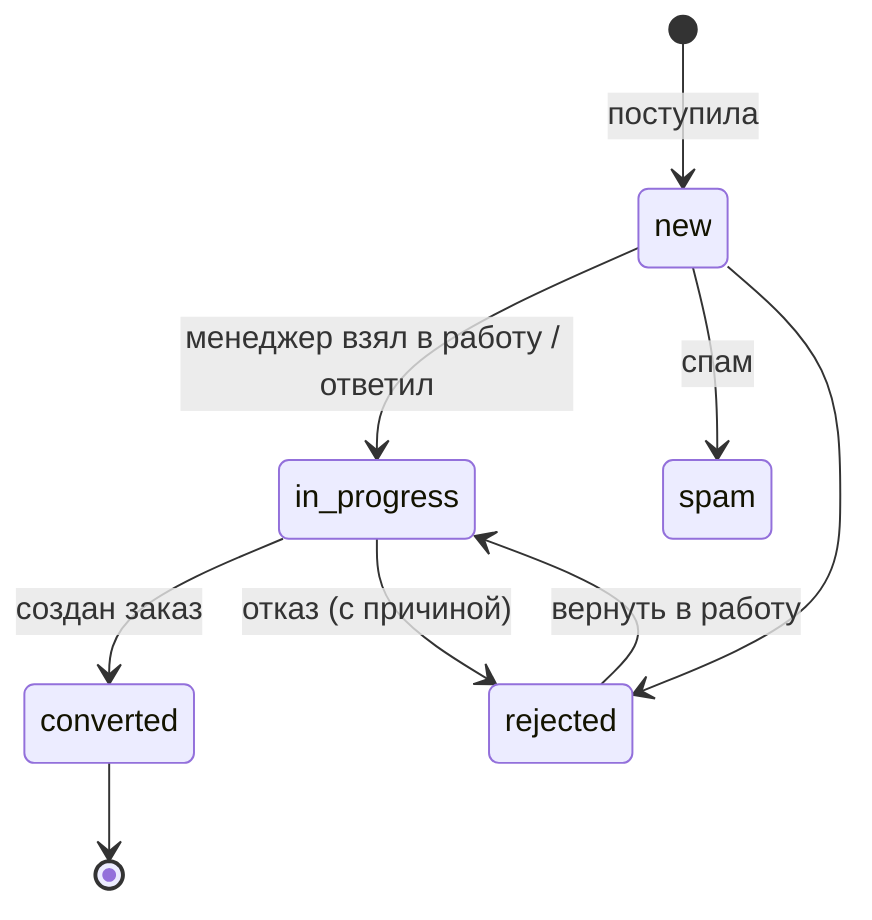

# Модуль 02. Заявки

Единый входящий поток обращений из всех каналов. Задача модуля — чтобы ни одна заявка не потерялась и каждая быстро получила ответственного. Сущности: `Lead`, `LeadSource`, `RejectReason` ([Модель данных](../03-модель-данных.md#5-заявки)).

## Жизненный цикл

## Источники заявок
| Канал | Как попадает | Этап |
|---|---|---|
| Ручной ввод (звонок, визит) | Менеджер создаёт форму | Э1 |
| Телефония | Входящий звонок с нового номера или пропущенный → заявка | Э4 |
| Почта | Письмо на общий ящик от неизвестного адреса → заявка | Э4 |
| Сайт | Webhook формы → заявка | Э4 |
| ВКонтакте | Новый диалог в сообществе → заявка | Э4 |
| Авито | Новый чат по объявлению → заявка | Э4 |
| Telegram | Клиент пишет боту → заявка | Э2 |

Подробности подключения — в [Интеграциях](../05-интеграции.md).

## Экраны
1. **Входящие заявки** — список/канбан по статусам, сверху счётчики «Новые», «Просрочены», «Мои».
2. **Карточка заявки** — данные обращения, клиент, переписка (если пришла из мессенджера или почты), действия.
3. **Быстрая форма заявки** — доступна с любого экрана по кнопке «+ Заявка» или горячей клавише.

## Требования
- **ЗАЯ-1** (Э1, обязательно). Быстрая форма: телефон или почта, имя, описание, канал, источник. Создание за 30 секунд. При вводе телефона система ищет клиента и подставляет его.
- **ЗАЯ-2** (Э1, обязательно). У каждой заявки срок первой реакции. По умолчанию 1 рабочий час (настраивается). Рабочее время компании задаётся в настройках (по умолчанию пн–пт 9:00–18:00).
- **ЗАЯ-3** (Э1, обязательно). Назначение ответственного:
  - вручную менеджером или руководителем;
  - автоматически по правилу (настройка): «на того, кто ведёт клиента», иначе «по кругу между менеджерами», иначе «без ответственного, всем менеджерам».
- **ЗАЯ-4** (Э1, обязательно). Уведомление о новой заявке ответственному (или всем менеджерам, если ответственного нет): в CRM, push, Telegram.
- **ЗАЯ-5** (Э1, обязательно). Если срок реакции истёк, а `first_response_at` пустой: заявка подсвечивается красным, ответственному и руководителю приходит уведомление «Заявка просрочена».
- **ЗАЯ-6** (Э1, обязательно). Первой реакцией считается: смена статуса на «В работе», исходящее сообщение клиенту, исходящий звонок клиенту (Э4), комментарий с отметкой «Связался».
- **ЗАЯ-7** (Э1, обязательно). Кнопка «Создать заказ»: выбор типа заказа, переносятся клиент (создаётся, если его нет), контакт, описание, источник. Заявка получает статус `converted` и ссылку на заказ.
- **ЗАЯ-8** (Э1, обязательно). Отказ только с причиной из справочника + комментарий.
- **ЗАЯ-9** (Э1, обязательно). Отметка «Спам» скрывает заявку из списков и не учитывается в аналитике.
- **ЗАЯ-10** (Э4, обязательно). Если в заявку пришло сообщение из мессенджера или почты, его видно в карточке, и на него можно ответить оттуда же.
- **ЗАЯ-11** (Э4, обязательно). Повторное сообщение от того же контакта в течение 7 дней не создаёт новую заявку, а добавляется в открытую.
- **ЗАЯ-12** (Э1, желательно). Отметка «Вопрос по статусу заказа» — для подсчёта метрики «Звонки “как там мой заказ?”». Такая заявка закрывается без конверсии и без причины отказа.
- **ЗАЯ-13** (Э1, обязательно). Заявки нельзя удалить, только отклонить или пометить как спам.

## Критерии приёмки
- Заявка, заведённая вручную, через минуту видна ответственному с уведомлением.
- Через час без реакции (в рабочее время) заявка становится просроченной, руководитель получает уведомление.
- Из заявки в 2 клика создаётся заказ с уже заполненным клиентом.
- Повторное сообщение от того же клиента не плодит дубли.
