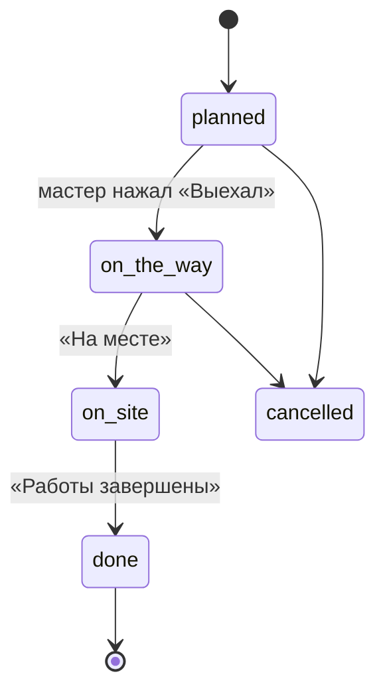

# Модуль 04. Выезды

Планирование и проведение выездного ремонта на объекте клиента. Главный пользователь на выезде — мастер со смартфоном. Сущности: `Visit`, `VisitAssignee`, `VisitKit` ([Модель данных](../03-модель-данных.md#7-выезды)).

## Статусы выезда

Статус выезда двигает этап заказа: `planned` → этап `visit_planned`, `on_site` → `on_site`, `done` → `visit_done` (или `moved_to_workshop`, если результат «Забираем в цех»).

## Экраны
1. **Календарь выездов** — неделя/день, по строке на мастера, цветом статус.
2. **Карточка выезда** — внутри заказа, вкладка «Выезды».
3. **Мобильный экран «Мой выезд»** — крупные кнопки для работы на объекте.

## Требования

### Планирование
- **ВЫЕ-1** (Э1, обязательно). Создание выезда из заказа: дата и время (начало и ориентировочное окончание), мастера, адрес (по умолчанию адрес клиента), контакт на объекте, что взять с собой (комментарий и с Э2 — список запчастей из склада).
- **ВЫЕ-2** (Э1, обязательно). Календарь: неделя и день, мастера по строкам. Перетаскивание выезда меняет время или мастера.
- **ВЫЕ-3** (Э1, обязательно). Предупреждение о пересечении: мастер уже занят в это время на другом выезде.
- **ВЫЕ-4** (Э1, обязательно). Мастер получает уведомление о назначенном выезде и напоминание вечером накануне (в 18:00) и за 1 час до начала.
- **ВЫЕ-5** (Э2, обязательно). Клиент получает уведомление «Выезд назначен: дата, время, мастер» и «Мастер выехал» (если включено в шаблонах).
- **ВЫЕ-6** (Э1, желательно). Кнопка «Маршрут» открывает адрес в Яндекс Картах (ссылка, без встроенной карты).

### На объекте (мобильный экран)
- **ВЫЕ-10** (Э1, обязательно). Кнопки «Выехал», «На месте», «Работы завершены» фиксируют время. Кнопки крупные, работают одной рукой.
- **ВЫЕ-11** (Э1, обязательно). Фото с камеры: «До», «Дефекты», «После». Загрузка в фоне, при плохой связи фото ставятся в очередь и догружаются, когда появится сеть.
- **ВЫЕ-12** (Э1, обязательно). Диагностика на месте: мастер добавляет предложенные работы и запчасти (как ЗАК-43). Менеджер видит их в реальном времени и может сразу согласовать с клиентом.
- **ВЫЕ-13** (Э1, обязательно). Отчёт: что сделано (текст или голосовой ввод средствами клавиатуры смартфона), результат: «Отремонтировано на месте» / «Забираем в цех» / «Нужен повторный выезд».
- **ВЫЕ-14** (Э2, обязательно). Подпись клиента пальцем на экране под актом выезда. Подпись сохраняется картинкой и вставляется в PDF акта.
- **ВЫЕ-15** (Э1, обязательно). Пробег в км и время в пути — для расчёта услуги «Выезд» в смете (тариф за выезд и за км задаётся в настройках).

### Запчасти на выезде
- **ВЫЕ-20** (Э2, обязательно). Перед выездом бухгалтер/кладовщик оформляет «Взял с собой»: запчасти перемещаются со склада «Цех» на склад «Выезд — <мастер>».
- **ВЫЕ-21** (Э2, обязательно). На объекте мастер отмечает, что использовал. Использованное списывается под заказ, неиспользованное по возвращении возвращается на основной склад (кнопка «Вернул на склад»).

### Перевод в цех
- **ВЫЕ-30** (Э1, обязательно). Результат «Забираем в цех» создаёт связанный заказ «Ремонт в цеху» на этапе «Принят в цех» с тем же клиентом и оборудованием, фото и отчётом выезда. Выездной заказ переходит в `moved_to_workshop`, его работы (выезд, диагностика) выставляются отдельно или переносятся в новый заказ — выбор менеджера.
- **ВЫЕ-31** (Э1, обязательно). Результат «Нужен повторный выезд» оставляет заказ открытым и создаёт задачу менеджеру «Запланировать повторный выезд». Метрика «Выезды, закрытые с первого раза» считает такие выезды неуспешными.

## Офлайн
- **ВЫЕ-40** (Э1, обязательно). Если связи нет, мобильный экран выезда работает: нажатия кнопок, отчёт и фото сохраняются на устройстве и отправляются при появлении сети. Мастер видит значок «Не отправлено (N)».
- **ВЫЕ-41** (Э1, обязательно). Перед выездом данные выезда (адрес, контакт, описание, смета без цен) кешируются на смартфоне.

## Критерии приёмки
- Менеджер планирует выезд, мастер получает уведомление на смартфон.
- Мастер в режиме полёта нажимает «На месте», делает 3 фото и пишет отчёт. После включения сети всё появляется в заказе с правильным временем.
- Результат «Забираем в цех» создаёт связанный заказ на ремонт с фото и отчётом.
- В календаре видны пересечения по мастеру.
