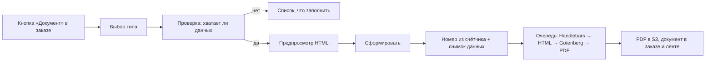

# Модуль 08. Документы

Автоматическое формирование документов по шаблонам. Состав и поля каждого документа — в [Шаблонах документов](../08-документы-шаблоны.md). Сущности: `Document`, `DocumentTemplate`, `DocumentCounter`, `Invoice`, `Payment` ([Модель данных](../03-модель-данных.md#11-документы-и-финансы)). Весь модуль — этап Э2.

## 1. Как формируется документ

## 2. Требования

### Формирование
- **ДОК-1** (Э2, обязательно). Типы документов: КП, смета, договор, акт приёмки, дефектная ведомость, протокол испытаний, счёт, акт выполненных работ, гарантийный талон, акт выезда.
- **ДОК-2** (Э2, обязательно). Документ формируется из карточки заказа (кнопка «Документ» и подсказки на этапах: на «Принят в цех» — «Сформировать акт приёмки», на «Готов к выдаче» — «Сформировать акт работ, счёт, гарантийный талон»).
- **ДОК-3** (Э2, обязательно). Перед формированием система проверяет обязательные данные (например, для счёта юрлицу — ИНН и реквизиты клиента, реквизиты компании) и показывает, чего не хватает, со ссылками на заполнение.
- **ДОК-4** (Э2, обязательно). Предпросмотр документа перед формированием. Можно поправить дату документа и дополнительные поля (комментарий, условия).
- **ДОК-5** (Э2, обязательно). При формировании сохраняется снимок данных (`data_snapshot`). Документ не меняется при последующих изменениях заказа. Если данные изменились — «Сформировать новую версию» (старая получает статус «Аннулирован»).
- **ДОК-6** (Э2, обязательно). PDF генерируется в фоне (до 10 секунд), пользователь видит индикатор, затем документ открывается.
- **ДОК-7** (Э2, обязательно). В документ подставляются логотип, реквизиты компании, подписант. Подпись и печать — по настройке (картинки, вставляются в счёт и акт).

### Нумерация
- **ДОК-10** (Э2, обязательно). У каждого типа своя сквозная нумерация в пределах года: `АП-2026-0012` (акт приёмки), `СЧ-2026-0045` (счёт), `АР-2026-0040` (акт работ). Префиксы и формат настраиваются.
- **ДОК-11** (Э2, обязательно). Номер берётся в транзакции с блокировкой счётчика — без пропусков и дублей.
- **ДОК-12** (Э2, обязательно). Если в 1С счета нумеруются по-своему, номер из 1С сохраняется дополнительно (`external_1c_id`) и показывается рядом (Э3).

### Статусы и хранение
- **ДОК-20** (Э2, обязательно). Статусы: черновик, сформирован, отправлен клиенту, подписан, аннулирован.
- **ДОК-21** (Э2, обязательно). Загрузка скана подписанного документа («Подписан», файл прикрепляется к документу).
- **ДОК-22** (Э2, обязательно). Список документов: в заказе, в карточке клиента и общий реестр с фильтрами (тип, период, клиент, статус).

### Отправка клиенту
- **ДОК-30** (Э2, обязательно). Кнопка «Отправить клиенту»: на почту (PDF во вложении, шаблон письма), в Telegram (если клиент подписан на бота), ссылкой на странице статуса заказа.
- **ДОК-31** (Э2, обязательно). Факт отправки — в ленте заказа и в статусе документа.

### Счета и оплаты
- **ДОК-40** (Э2, обязательно). Счёт: на предоплату (процент или сумма) или итоговый (сумма сметы минус ранее выставленные предоплаты). Срок оплаты = дата + отсрочка клиента.
- **ДОК-41** (Э2, обязательно). Оплата вносится вручную: сумма, дата, способ (наличные, карта, безнал, СБП), к какому счёту. С Э3 безналичные оплаты приходят из 1С.
- **ДОК-42** (Э2, обязательно). Статус счёта пересчитывается автоматически: выставлен → частично оплачен → оплачен. Просроченный счёт (дата оплаты прошла) подсвечивается, создаётся задача (ЗАД-7).
- **ДОК-43** (Э2, обязательно). Оплата наличными за выездной ремонт — мастер может отметить «Получил наличные N ₽», бухгалтер подтверждает приём кассы.
- **ДОК-44** (Э2, обязательно). В заказе сводка: итог по смете, выставлено, оплачено, долг.
- **ДОК-45** (Э3, желательно). Онлайн-касса и печать чеков вне рамок ТЗ: для физлиц чек пробивается в существующей кассе, в CRM ставится отметка «Чек пробит».

### Редактор шаблонов
- **ДОК-50** (Э2, обязательно). Шаблоны хранятся в БД (HTML + CSS + Handlebars). При первом запуске создаются шаблоны по умолчанию из [Шаблонов документов](../08-документы-шаблоны.md).
- **ДОК-51** (Э2, обязательно). Администратор может отредактировать шаблон (редактор кода с предпросмотром на реальном заказе). Каждое сохранение — новая версия, можно откатиться.
- **ДОК-52** (Э2, обязательно). Список доступных переменных показывается рядом с редактором (`{{company.name}}`, `{{order.number}}`, `{{#each items}}` и т.д.).
- **ДОК-53** (Э3, желательно). Визуальный редактор шаблонов (без HTML) — вне MVP, по запросу.

## Критерии приёмки
- Акт приёмки формируется в 2 клика на этапе «Принят в цех», в PDF есть фото агрегата и комплектность.
- Счёт юрлицу без ИНН не формируется, система показывает, что заполнить.
- Номера счетов идут подряд без пропусков даже при одновременном формировании.
- После изменения сметы сформированный ранее счёт не меняется.
- Документ отправлен клиенту на почту, событие видно в ленте заказа.
