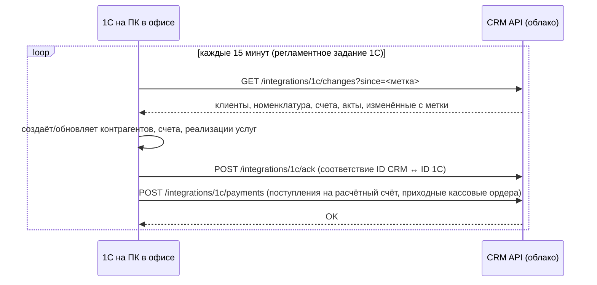

# 05. Интеграции

## 0. Общие принципы
Общие принципы закладываются в Э1 вместе со служебным Telegram-ботом — первой интеграцией.

- **ИНТ-1** (Э1, обязательно). Каждая интеграция — отдельный модуль NestJS в `apps/api/src/integrations/<имя>` с общим интерфейсом адаптера. Замена поставщика (другой SMS-агрегатор, другой оператор телефонии) — новый адаптер без изменения остального кода.
- **ИНТ-2** (Э1, обязательно). Настройки интеграций в разделе «Настройки → Интеграции»: включить/выключить, ключи и параметры (секреты шифруются, АРХ-19), кнопка «Проверить подключение», дата последнего обмена, последняя ошибка.
- **ИНТ-3** (Э1, обязательно). Входящие webhooks принимаются быстро (ответ за 1 секунду), обработка — в очереди.
- **ИНТ-4** (Э1, обязательно). Все исходящие вызовы — через очередь с повторами (экспоненциальная задержка, до 5 попыток). Окончательно упавшие видны в «Интеграции → Ошибки» (АРХ-73), их можно перезапустить.
- **ИНТ-5** (Э1, обязательно). Идемпотентность: входящее событие с уже обработанным `external_id` игнорируется.
- **ИНТ-6** (Э1, обязательно). Все обмены пишутся в `integration_logs` (хранение 90 дней), секреты в логах маскируются.

## 1. 1С:Бухгалтерия предприятия
**Этап:** Э3. **Исходные условия:** 1С:БП 3.0 установлена на ПК в офисе, из интернета этот ПК недоступен.

### Схема

Обмен инициирует 1С, поэтому ничего не нужно открывать в интернет со стороны офиса.

### Что передаётся
| Данные | Направление | Объект 1С |
|---|---|---|
| Клиенты (ИП, юрлица, дилеры; физлица — по настройке) | CRM → 1С | Справочник «Контрагенты» + «Договоры контрагентов» |
| Номенклатура (запчасти, услуги) | CRM → 1С | Справочник «Номенклатура» |
| Счета | CRM → 1С | Документ «Счёт покупателю» |
| Акты выполненных работ | CRM → 1С | Документ «Реализация (акт, накладная, УПД)» |
| Оплаты | 1С → CRM | Документы «Поступление на расчётный счёт», «Приходный кассовый ордер» с привязкой к счёту |
| Номера документов 1С | 1С → CRM | Сохраняются в `external_1c_id` |

### Требования
- **ИНТ-10** (Э3, обязательно). REST API для 1С: `GET /api/v1/integrations/1c/changes`, `POST /api/v1/integrations/1c/ack`, `POST /api/v1/integrations/1c/payments`. Авторизация — API-ключ в заголовке `X-Api-Key`, выдаётся в настройках, можно перевыпустить.
- **ИНТ-11** (Э3, обязательно). Внешняя обработка 1С (`.epf`) с регламентным заданием: настройки (адрес CRM, ключ, интервал), ручной запуск, журнал обмена. Пишется на встроенном языке 1С. Детальная спецификация обработки составляется в начале Э3 вместе с бухгалтером.
- **ИНТ-12** (Э3, обязательно). Сопоставление по ИНН+КПП для контрагентов и по артикулу для номенклатуры при первом обмене (чтобы не создавать дубли существующих в 1С записей).
- **ИНТ-13** (Э3, обязательно). Оплата из 1С привязывается к счёту по номеру счёта в назначении платежа или по `external_1c_id` счёта. Непривязанные оплаты попадают в список «Неразнесённые оплаты» у бухгалтера.
- **ИНТ-14** (Э3, обязательно). Изменения в CRM после выгрузки (например, исправили реквизиты) передаются повторно. Документы, проведённые в 1С, CRM не перезаписывает — только помечает расхождение.
- **ИНТ-15** (Э3, обязательно). Отчёт расхождений: счета и акты, которые есть в CRM, но не дошли до 1С, и оплаты из 1С без привязки. Метрика «Расхождения с 1С».
- **ИНТ-16** (Э3, обязательно). Если обмена не было больше 2 часов в рабочее время — уведомление бухгалтеру.

## 2. IP-телефония
**Этап:** Э4. **Оператор:** пока не выбран. Рекомендации: **Novofon** (бывш. Zadarma) или **Mango Office** — у обоих webhooks о звонках, API для звонка из CRM и записи разговоров. Выбор — в начале Э4 по цене минуты и тарифу на 6–20 сотрудников.

- **ИНТ-20** (Э4, обязательно). Общий адаптер телефонии: события `call.incoming`, `call.answered`, `call.ended`, `call.missed`, `recording.ready`; действие `makeCall(fromUser, toNumber)`.
- **ИНТ-21** (Э4, обязательно). Входящий звонок: всплывающая карточка у сотрудника, которому звонят (клиент, открытые заказы, последний комментарий) или «Новый номер — создать заявку».
- **ИНТ-22** (Э4, обязательно). Каждый звонок сохраняется в `calls` и показывается в истории клиента и заказа. Запись разговора — плеер в карточке (запись копируется в S3).
- **ИНТ-23** (Э4, обязательно). Пропущенный звонок с неизвестного номера → заявка с каналом `phone`. С известного → задача менеджеру клиента «Перезвонить».
- **ИНТ-24** (Э4, обязательно). Звонок из CRM кликом по номеру: оператор сначала звонит сотруднику, затем соединяет с клиентом.
- **ИНТ-25** (Э4, обязательно). Соответствие внутренних номеров и пользователей CRM — в настройках интеграции.

## 3. Почта
**Этап:** Э2 (исходящая), Э4 (входящая).

- **ИНТ-30** (Э2, обязательно). Исходящая почта через SMTP общего ящика компании (например, `service@домен`). Используется для документов, уведомлений клиенту, ответов из CRM.
- **ИНТ-31** (Э4, обязательно). Входящая почта: опрос IMAP общего ящика каждые 2 минуты. Письмо от известного адреса → `ClientMessage` в карточке клиента (и в заказе, если в теме есть номер заказа или это ответ на письмо из CRM). От неизвестного → заявка.
- **ИНТ-32** (Э4, обязательно). Ответы из CRM уходят с заголовками `In-Reply-To`/`References`, чтобы у клиента письма шли одной цепочкой, а ответ клиента привязывался к тому же заказу.
- **ИНТ-33** (Э4, обязательно). Вложения писем сохраняются в S3 и доступны в карточке.
- **ИНТ-34** (Э4, обязательно). Фильтр автоответов и рассылок (по заголовкам `Auto-Submitted`, `List-Unsubscribe`, чёрный список адресов) — они не создают заявки.
- **ИНТ-35** (Э2, обязательно). Настройка SPF, DKIM, DMARC для домена — в инструкции по запуску, чтобы письма не попадали в спам.

## 4. Сайт
**Этап:** Э4.

- **ИНТ-40** (Э4, обязательно). Эндпоинт `POST /api/v1/public/site-lead` принимает форму сайта: имя, телефон, почта, сообщение, страница, UTM-метки. Защита: секретный ключ формы, лимит 10 заявок с IP в час, скрытое поле-ловушка от ботов.
- **ИНТ-41** (Э4, обязательно). UTM-метки сохраняются в заявке и используются в аналитике источников.
- **ИНТ-42** (Э4, обязательно). Готовый фрагмент кода (HTML + JS) для вставки в форму сайта — в разделе настроек интеграции.

## 5. ВКонтакте
**Этап:** Э4.

- **ИНТ-50** (Э4, обязательно). Подключение сообщества через Callback API: ключ доступа сообщества с правом сообщений, строка подтверждения, секретный ключ.
- **ИНТ-51** (Э4, обязательно). Событие `message_new` → `ClientMessage`. Привязка к клиенту по ID пользователя ВКонтакте (хранится в контактах клиента), новый пользователь → заявка с каналом `vk`.
- **ИНТ-52** (Э4, обязательно). Ответ из CRM — метод `messages.send` от имени сообщества.
- **ИНТ-53** (Э4, желательно). Заявки из формы VK-рекламы (lead forms) → заявки CRM.

## 6. Авито
**Этап:** Э4.

- **ИНТ-60** (Э4, обязательно). Подключение через Авито API для бизнеса: client_id и client_secret, OAuth-токен с автообновлением. Требуется тариф Авито с доступом к API мессенджера — проверить перед стартом этапа.
- **ИНТ-61** (Э4, обязательно). Webhook мессенджера: новое сообщение → `ClientMessage`. Новый чат → заявка с каналом `avito`, в заявке — название и ссылка на объявление.
- **ИНТ-62** (Э4, обязательно). Ответ из CRM — метод отправки сообщения в чат.
- **ИНТ-63** (Э4, обязательно). Источник заявки определяется по объявлению (можно сопоставить объявления с источниками: «Авито — ремонт», «Авито — сборка»).

## 7. Telegram
**Этап:** Э1 (служебный бот для сотрудников), Э2 (бот для клиентов).

Два бота, чтобы клиенты и сотрудники не смешивались:
| Бот | Для кого | Что делает |
|---|---|---|
| Служебный | Сотрудники | Уведомления (ЗАД-20), утренняя сводка. Привязка по одноразовой ссылке из профиля |
| Клиентский | Клиенты | Уведомления о заказах, «Мои заказы», переписка с менеджером, приём заявок (УВК-30…33) |

- **ИНТ-70** (Э1, обязательно). Работа через Bot API в режиме webhook. Токены ботов в настройках интеграции.
- **ИНТ-71** (Э2, обязательно). Клиентский бот: сообщения клиента → `ClientMessage` (канал `telegram`), ответы менеджера из CRM → сообщение от бота. Фото и файлы от клиента сохраняются.
- **ИНТ-72** (Э2, обязательно). Новый пользователь пишет боту без привязки к заказу → бот просит описать задачу и телефон (кнопка «Поделиться номером»), создаётся заявка.
- **ИНТ-73** (Э2, обязательно). Ограничения Telegram на частоту (30 сообщений в секунду) учитываются очередью.

## 8. SMS
**Этап:** Э2.

- **ИНТ-80** (Э2, обязательно). Адаптер к SMS-агрегатору: первым подключаем **SMS.ru** или **SMSC.ru** (простое HTTP API, оплата по факту). Имя отправителя (буквенное) регистрируется у агрегатора.
- **ИНТ-81** (Э2, обязательно). Статусы доставки получаем по webhook или опросом, стоимость сообщения сохраняется в `client_notifications.cost_kop`.
- **ИНТ-82** (Э2, обязательно). Отчёт расходов на SMS за месяц и лимит расходов в месяц (при достижении SMS не отправляются, администратор получает уведомление).
- **ИНТ-83** (Э2, обязательно). В SMS не отправляются персональные данные и суммы, кроме номера заказа и ссылки на статус.

## 9. DaData (подсказки по реквизитам)
- **ИНТ-90** (Э2, желательно). Подсказки организаций по ИНН и названию, адресов (бесплатный тариф, до 10 000 запросов в день). Используется в форме клиента (КЛН-22) и реквизитах компании.

## 10. Чек-лист перед подключением каждой интеграции
1. Получить доступы (ключи, токены, тариф с API).
2. Подключить в тестовом режиме, проверить кнопкой «Проверить подключение».
3. Отправить тестовое событие и убедиться, что оно появилось в CRM.
4. Проверить ошибку: отключить ключ — ошибка видна в «Интеграции → Ошибки», после исправления повтор проходит.
5. Включить для всех.
