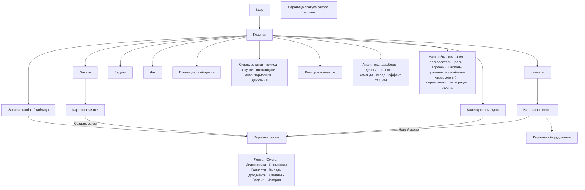

# 07. Интерфейс

## 1. Принципы
- **ИНФ-1** (Э1). Одно приложение для ПК и смартфона: адаптивная вёрстка, на ширине меньше 768 px — мобильный режим с нижним меню.
- **ИНФ-2** (Э1). Главное действие на экране — одно и заметное («Следующий этап», «Создать заказ»). Частые действия — в 1–2 клика.
- **ИНФ-3** (Э1). Мастеру в цеху и на выезде — крупные кнопки (не меньше 48×48 px), минимум ввода с клавиатуры, фото с камеры в один тап.
- **ИНФ-4** (Э1). Светлая и тёмная тема (переключатель в профиле, по умолчанию — как в системе).
- **ИНФ-5** (Э1). Все списки сохраняют фильтры и сортировку при возврате на экран.
- **ИНФ-6** (Э1). Глобальный поиск в шапке (`Ctrl+K`): клиенты, заказы по номеру, оборудование по серийному номеру, заявки, номенклатура.
- **ИНФ-7** (Э1). Пустые состояния с подсказкой, что делать («Заявок пока нет. Создайте первую или подключите каналы»).
- **ИНФ-8** (Э1). Ошибки показываются понятным текстом из `error.message` (API-32), с указанием поля в формах.

## 2. Навигация на ПК
Левое меню (сворачивается), набор пунктов зависит от прав:
| Пункт | Кто видит |
|---|---|
| Главная (дашборд) | Все (у каждой роли свой) |
| Заявки | admin, director, manager, accountant |
| Заказы (канбан / таблица) | Все |
| Выезды (календарь) | admin, director, manager, master |
| Клиенты | Все, кроме мастера (мастер видит клиентов через заказы) |
| Задачи | Все |
| Чат | Все |
| Входящие сообщения (Э4) | admin, director, manager |
| Склад (Э2) | admin, director, accountant; manager, master — только «Остатки» |
| Документы (Э2) | admin, director, manager, accountant |
| Аналитика | admin, director; accountant — деньги и склад |
| Настройки | admin, director |

Шапка: глобальный поиск, кнопка «+ Создать» (заявка, заказ, клиент, задача), уведомления, чат (счётчик непрочитанных), профиль.

## 3. Главная по ролям
| Роль | Что на главной |
|---|---|
| Руководитель | Дашборд (АНЛ-10, с Э3 — АНЛ-11): заявки, застрявшие заказы, просрочки, выезды сегодня, деньги |
| Менеджер | Мои новые и просроченные заявки, мои заказы по этапам, ждут согласования сметы, готовы к выдаче, мои задачи на сегодня |
| Мастер | Мои заказы в работе (по этапам), мои выезды сегодня, мои задачи |
| Бухгалтер | Счета к выставлению (заказы на «Готов к выдаче» без счёта), просроченные счета, неразнесённые оплаты (Э3), остатки ниже минимума, закупки в пути |

## 4. Карта экранов


## 5. Карточка заказа (ПК)
```
┌─────────────────────────────────────────────────────────────────────────┐
│ З-2026-0042  Ремонт в цеху   [Диагностика ▾]   [Следующий этап →]       │
│ ООО «Пресс-Мастер» · Маслостанция пресса №2 (сер. № 12345)              │
│ Менеджер: Иванов  ·  Мастера: Петров (гл.), Сидоров  ·  Срок: 20.10     │
│ ●──●──●──◉──○──○──○──○──○──○   Принят 13.10 → Диагностика с 14.10       │
├──────────────────────────────────────────────┬──────────────────────────┤
│ Лента | Смета | Диагностика | Испытания | …  │ Клиент                   │
│                                              │ Контакт, телефон         │
│ [Написать комментарий… @  📎  📷]            │ Оборудование             │
│                                              │ Задачи по заказу (2)     │
│ Петров · 10:15  Течь по валу насоса, фото ↓  │ Документы (1)            │
│ [фото] [фото]                                │ Оплата: 0 из 45 000 ₽    │
│ ⚙ Иванов перевёл в «Диагностика» · 09:00     │ Ссылка на статус  [⧉]    │
└──────────────────────────────────────────────┴──────────────────────────┘
```

## 6. Мобильная версия (PWA)
- **ИНФ-20** (Э1). Устанавливается на главный экран смартфона (Android — кнопка «Установить», iOS — инструкция «Поделиться → На экран Домой»). Иконка, название «ГидроCRM», запуск без адресной строки.
- **ИНФ-21** (Э1). Нижнее меню: «Главная», «Заказы», «Выезды», «Чат», «Ещё».
- **ИНФ-22** (Э1). Карточка заказа на смартфоне: шапка с этапом и большой кнопкой «Следующий этап», вкладки свайпом, кнопка-камера поверх ленты.
- **ИНФ-23** (Э1). Мобильный экран «Мой выезд» (см. ВЫЕ-10…15): адрес и «Маршрут», контакт и «Позвонить», большие кнопки статусов, фото, отчёт, предложить работы, подпись клиента (Э2).
- **ИНФ-24** (Э1). Офлайн-режим для выездов и отправка фото из очереди (ВЫЕ-40, ВЫЕ-41). Остальные экраны при отсутствии сети показывают последние загруженные данные с пометкой «Нет сети».
- **ИНФ-25** (Э1). Push-уведомления (ЗАД-20). Разрешение запрашивается после входа с объяснением, зачем оно нужно.
- **ИНФ-26** (Э1). Фото сжимаются на устройстве (ЗАК-33), загрузка показывает прогресс.

## 7. Компоненты и стиль
- **ИНФ-30** (Э0). Ant Design 5 с собственной темой (основной цвет — синий индустриальный, настраивается через токены темы). Шрифт системный.
- **ИНФ-31** (Э0). Общие компоненты в `apps/web/src/shared/ui`: `MoneyInput`, `PhoneInput`, `MoneyText` (форматирование `45 000,00 ₽`), `StageBadge`, `UserAvatar`, `FileUploader`, `CameraButton`, `EntityLink`, `EmptyState`.
- **ИНФ-32** (Э1). Форматы: даты `13.10.2026`, время `14:30`, телефоны `+7 912 345-67-89`, деньги с пробелами между разрядами.
- **ИНФ-33** (Э1). Доступность: управление с клавиатуры в формах и таблицах, контраст текста не ниже 4.5:1, подписи у иконок-кнопок.

## 8. Настройки (для администратора и руководителя)
| Раздел | Что настраивается | Этап |
|---|---|---|
| Компания | Реквизиты, логотип, подпись и печать, рабочее время, часовой пояс, НДС | Э1 (реквизиты — Э2) |
| Пользователи | Создание, роли, деактивация, сброс пароля | Э1 |
| Роли | Права ролей галочками | Э1 |
| Воронки | Этапы: название, название для клиента, порядок, норма, производственный, уведомлять клиента, скрыть от клиента, цвет | Э1 |
| Видимость | Настройки из [Роли и права](02-роли-и-права.md#5-настройки-видимости-уровень-компании) | Э1 |
| Справочники | Источники, причины отказа, категории, единицы, параметры испытаний | Э1 |
| Автоматические задачи | Правила ЗАД-7 | Э1 |
| Шаблоны документов | Редактор (ДОК-50…52), нумерация | Э2 |
| Шаблоны уведомлений клиенту | УВК-10, УВК-11 | Э2 |
| Гарантия | Сроки по умолчанию | Э2 |
| Тарифы выезда | Цена выезда, цена за км | Э1 |
| Интеграции | ИНТ-2 | Э1–Э4 |
| Журнал действий | Просмотр с фильтрами | Э1 |
