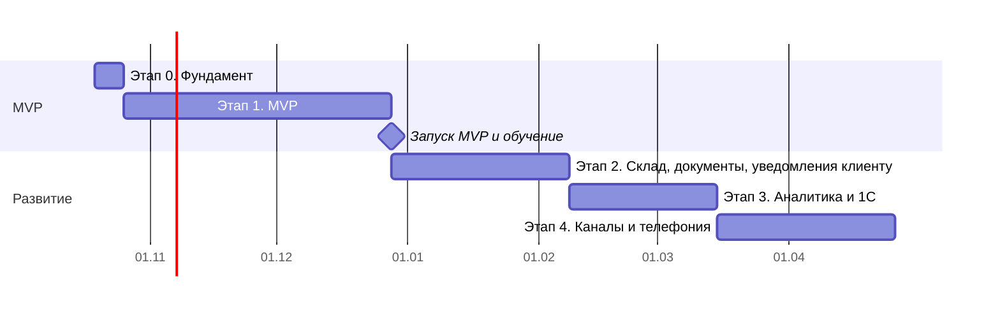

# 09. План этапов

Сроки ориентировочные, исходя из разработки владельцем вместе с Claude. Этапы 0 и 1 вместе — это MVP за 2–3 месяца из «Идеи проекта».

## Этап 0. Фундамент (≈1 неделя)
**Цель:** пустое, но работающее приложение со входом, ролями и автоматической проверкой кода.

**Подготовить заранее:** аккаунт GitHub, Node.js 20 LTS, pnpm, Docker Desktop на компьютере разработки.

| № | Задача | Требования |
|---|---|---|
| 0.1 | `git init`, монорепозиторий pnpm: `apps/api`, `apps/web`, `packages/shared`, общие настройки TypeScript, ESLint, Prettier, Husky | АРХ, структура из 01 |
| 0.2 | `infra/docker-compose.yml`: postgres, redis, minio, gotenberg, mailpit | АРХ-50 |
| 0.3 | NestJS: конфигурация, логирование pino, единый формат ошибок, `/health`, Swagger | API-1, API-30…32, АРХ-70, 71 |
| 0.4 | Prisma: схема `Company`, `User`, `Role`, `UserRole`, `RefreshToken`, `AuditLog`; расширение Prisma с фильтром `company_id`; seed: компания, 5 ролей, администратор | АРХ-1, АРХ-3, ПРВ-1, ПРВ-2 |
| 0.5 | Авторизация: вход, refresh с ротацией, выход, блокировка после 5 попыток, `/auth/me` | АРХ-11, 12, API-10…12 |
| 0.6 | Права: константы `Permission` в shared, guard по действию, тесты 200/403 | ПРВ-10, 13, 14 |
| 0.7 | React: Vite, Ant Design с темой и русской локалью, роутинг, TanStack Query, экран входа, layout с меню по правам, профиль | ИНФ-1, 30, 31 |
| 0.8 | CI в GitHub Actions: линтер, проверка типов, тесты | АРХ-93 |

**Готово, когда:** `docker compose up` + `pnpm dev` поднимают систему, администратор входит, видит пустой каркас; пользователь без прав получает 403; CI зелёный.

## Этап 1. MVP (≈8–9 недель)
**Цель:** команда ведёт в CRM все заявки и заказы, общается внутри системы, мастера работают со смартфона.

**Подготовить заранее:** домен (например, `crm.<ваш-домен>.ru`), VPS у российского хостинга (2 vCPU / 4 ГБ / 40 ГБ), бакет S3, служебный Telegram-бот (создать через @BotFather).

| № | Задача | Требования | Неделя |
|---|---|---|---|
| 1.1 | Пользователи и настройки: создание сотрудников, роли, деактивация с передачей дел, сброс пароля, рабочее время, видимость | ПРВ-3, 4, API-13, ИНФ раздел 8 | 1 |
| 1.2 | Журнал действий (перехватчик для всех изменений, просмотры карточек клиентов), мягкое удаление, лимиты запросов, шифрование секретов | АРХ-17, 19, 22, 30…33, 40, 41 | 1 |
| 1.3 | Файлы: загрузка в S3 по подписанным ссылкам, превью, сжатие фото в браузере | АРХ-15, 16, API-50, 51, ЗАК-33 | 1 |
| 1.4 | Клиенты: список, поиск, карточка, контакты, оборудование, проверка дублей | КЛН-1…3, 10, 11, 20, 21, 23…25, 40…43, 60 | 2 |
| 1.5 | Заявки: быстрая форма, срок реакции, назначение, просрочка, отказ, конвертация в заказ | ЗАЯ-1…9, 12, 13 | 3 |
| 1.6 | Воронки и этапы: seed четырёх воронок, настройка этапов | §1 модуля Заказы, АРХ-2 | 3 |
| 1.7 | Заказы: создание, карточка, канбан, таблица, фильтры, смена этапов с проверками, история этапов, «без движения», защита от одновременного изменения | ЗАК-1…5, 7, 10…13, 20…22, 30…32, 50, 51, API-40 | 4–5 |
| 1.8 | Смета: позиции, предложения мастера, согласование, доп. работы, лимит скидки, маржа по правам | ЗАК-40…46, ПРВ-11 | 5 |
| 1.9 | WebSocket: комнаты, события заказов, фильтрация по правам | API-60…64, ЗАК-12 | 5 |
| 1.10 | Лента заказа: комментарии, фото, упоминания, системные события, непрочитанные | ОБЩ-1…7 | 6 |
| 1.11 | Внутренний чат: каналы, личные диалоги, ссылки на заказы, перенос в заказ, поиск | ОБЩ-10…18 | 6 |
| 1.12 | Задачи: создание отовсюду, «Мои задачи», просрочки, автоматические задачи Э1 | ЗАД-1…7 | 7 |
| 1.13 | Каркас интеграций (адаптеры, очередь с повторами, журнал, раздел «Ошибки») и уведомления: в CRM, Web Push, служебный Telegram-бот, настройки, «Не беспокоить», группировка | ИНТ-1…6, 70, АРХ-73, ЗАД-20…26 | 7 |
| 1.14 | Выезды: планирование, календарь, мобильный экран, отчёт, перевод в цех, повторный выезд | ВЫЕ-1…4, 6, 10…13, 15, 30, 31 | 8 |
| 1.15 | PWA: установка, нижнее меню, офлайн-очередь для выездов и фото | ИНФ-20…26, ВЫЕ-40, 41 | 8 |
| 1.16 | Главные экраны по ролям, простой дашборд руководителя, глобальный поиск | ИНФ-6, раздел 3, АНЛ-10 | 9 |
| 1.17 | Сервер: docker-compose.prod, Caddy, выкладка из GitHub Actions, бэкапы, мониторинг, Sentry | АРХ-10, 20, 51…55, 60…62, 71, 72 | 9 |
| 1.18 | E2E-тесты ключевых сценариев | АРХ-92 | 9 |
| 1.19 | Песочница для портфолио: демо-режим, вход по ролям, демо-данные, ночной сброс | ДЕМ-1…6 | 9 |

**Запуск MVP:**
1. Завести сотрудников, настроить этапы под реальную работу.
2. Перенести текущих клиентов и открытые заказы (импорт клиентов из Excel — разовый скрипт).
3. Провести обучение по ролям (30–60 минут на роль), установить PWA мастерам.
4. Договориться с командой: с даты запуска все заказы и обсуждения по ним — только в CRM.
5. Начать замер метрик (точка отсчёта из раздела 8 «Идеи проекта» замеряется **до** запуска, за 2–4 недели).

**Готово, когда:** выполнены критерии приёмки модулей Клиенты, Заявки, Заказы, Выезды, Общение, Задачи (в части Э1); система работает на сервере по HTTPS; бэкап восстанавливается; вся команда работает в CRM неделю без возврата к старым чатам.

## Этап 2. Склад, документы, уведомления клиенту (≈6 недель)
**Подготовить заранее:** реквизиты компании, логотип, скан подписи и печати; список запчастей с остатками в Excel; SMTP общего ящика (и SPF/DKIM для домена); клиентский Telegram-бот; аккаунт у SMS-агрегатора с зарегистрированным именем отправителя.

| № | Задача | Требования |
|---|---|---|
| 2.1 | Номенклатура, категории, прайс работ, импорт из Excel | СКЛ-1…4 |
| 2.2 | Остатки, приход, сторно, себестоимость | СКЛ-10…12, 20…23, 80…82 |
| 2.3 | Резерв и списание под заказ, связь со сметой | СКЛ-30…36, ЗАК-3 (запчасти) |
| 2.4 | Поставщики, закупки, закупка по дефициту | СКЛ-50…53 |
| 2.5 | Инвентаризация, перемещения, склад выезда | СКЛ-60, 61, 70, ВЫЕ-20, 21 |
| 2.6 | Сборка типовых станций: состав, заполнение сметы, приход на склад | СКЛ-40, 41, ЗАК-23 |
| 2.7 | Движок документов: Handlebars + Gotenberg, счётчики, снимок данных, версии | ДОК-1…7, 10, 11, 20…22 |
| 2.8 | 10 шаблонов документов по умолчанию, редактор шаблонов | 08-документы-шаблоны, ДОК-50…52 |
| 2.9 | Испытания и дефектная ведомость в заказе, проверки этапа «Готов» | ЗАК-3 (испытания), модель `test_results`, `defect_entries` |
| 2.10 | Счета и оплаты, долг клиента, отсрочки, прайс-листы дилеров | ДОК-40…44, КЛН-12, 50, 51 |
| 2.11 | Отправка документов клиенту, исходящая почта | ДОК-30, 31, ИНТ-30, 35 |
| 2.12 | Уведомления клиенту: шаблоны, правила каналов, очередь, ночной режим | УВК-1…4, 10…16 |
| 2.13 | Страница статуса заказа с согласованием сметы, политика ПД | УВК-20…27, ЗАК-60, АРХ-21 |
| 2.14 | Клиентский Telegram-бот, проверка подписи webhooks | УВК-30…33, ИНТ-71…73, АРХ-18 |
| 2.15 | SMS-адаптер, статусы, лимит расходов | ИНТ-80…83 |
| 2.16 | Гарантия и напоминания, подпись клиента на выезде, DaData | ЗАК-70, 71, ВЫЕ-14, КЛН-22 |

**Готово, когда:** выполнены критерии приёмки модулей Склад, Документы, Уведомления клиенту; инвентаризация после месяца работы показывает точность остатков ≥ 98%.

## Этап 3. Аналитика и 1С (≈5 недель)
**Подготовить заранее:** доступ к 1С:БП на офисном ПК, встреча с бухгалтером (какие документы и как сейчас вводятся, нумерация, договоры), значения «точки отсчёта» метрик.

| № | Задача | Требования |
|---|---|---|
| 3.1 | Каркас отчётов: периоды, сравнение, переход к спискам, выгрузка в Excel | АНЛ-1…5 |
| 3.2 | Деньги: выручка, маржа, дебиторка, план/факт | АНЛ-20…25 |
| 3.3 | Воронка, источники, отказы, время реакции, повторные клиенты | АНЛ-30…34 |
| 3.4 | Команда: загрузка, менеджеры, сроки, выезды, гарантия | АНЛ-40…44 |
| 3.5 | Склад: остатки, оборачиваемость, дефицит, простои | АНЛ-50…53 |
| 3.6 | Полный дашборд руководителя | АНЛ-11 |
| 3.7 | Страница «Эффект от CRM» | АНЛ-60…62 |
| 3.8 | API обмена с 1С, ключи интеграций | ИНТ-10, API-14 |
| 3.9 | Спецификация и внешняя обработка 1С (.epf), первичное сопоставление | ИНТ-11, 12 |
| 3.10 | Оплаты из 1С, номера документов 1С, неразнесённые оплаты, отчёт расхождений, контроль обмена | ИНТ-13…16, ДОК-12 |
| 3.11 | Желательное из Э1–Э2: объединение дублей, выгрузка клиентов, повторяющиеся задачи, обезличивание | КЛН-4, 30, ЗАД-8, АРХ-23 |

**Готово, когда:** выполнены критерии приёмки модуля Аналитика; месяц обмена с 1С без ручного переноса счетов и актов, расхождений 0.

## Этап 4. Каналы и телефония (≈6 недель)
**Подготовить заранее:** выбрать и подключить оператора телефонии (Novofon или Mango Office), доступ к сообществу ВКонтакте (администратор), тариф Авито с API мессенджера, доступ к коду формы на сайте.

| № | Задача | Требования |
|---|---|---|
| 4.1 | Переписка с клиентом: единая модель сообщений, вкладка «Переписка», «Входящие сообщения», ответы из CRM | ОБЩ-20…27 |
| 4.2 | Входящая почта (IMAP), цепочки писем, фильтр автоответов | ИНТ-31…34 |
| 4.3 | Форма сайта, UTM | ИНТ-40…42 |
| 4.4 | ВКонтакте | ИНТ-50…53 |
| 4.5 | Авито | ИНТ-60…63 |
| 4.6 | Заявки из каналов, склейка повторных сообщений | ЗАЯ-10, 11 |
| 4.7 | Телефония: адаптер, всплывающая карточка, звонки и записи в истории, пропущенные, звонок из CRM | ИНТ-20…25 |

**Готово, когда:** заявки из всех 7 каналов автоматически попадают в CRM; менеджер отвечает клиенту в любом канале, не выходя из CRM; звонки и записи видны в карточке клиента.

## После этапа 4
- Подведение итогов по метрикам «Идеи проекта» через 6 месяцев после запуска MVP.
- Решение о подготовке к продаже другим компаниям: регистрация компаний, изоляция данных (уже заложена `company_id`), биллинг, онбординг, настройка воронок и шаблонов без разработчика. Отдельное ТЗ.

## Порядок работы над каждой задачей
1. Открыть требования задачи в ТЗ.
2. Схема данных (Prisma) и миграция → API (сервис, контроллер, права, тесты) → интерфейс → e2e, если сценарий ключевой.
3. Коммит со ссылками на коды требований (`ЗАК-40, ЗАК-41: смета заказа`).
4. Если по ходу требование изменилось — поправить ТЗ в том же коммите.
